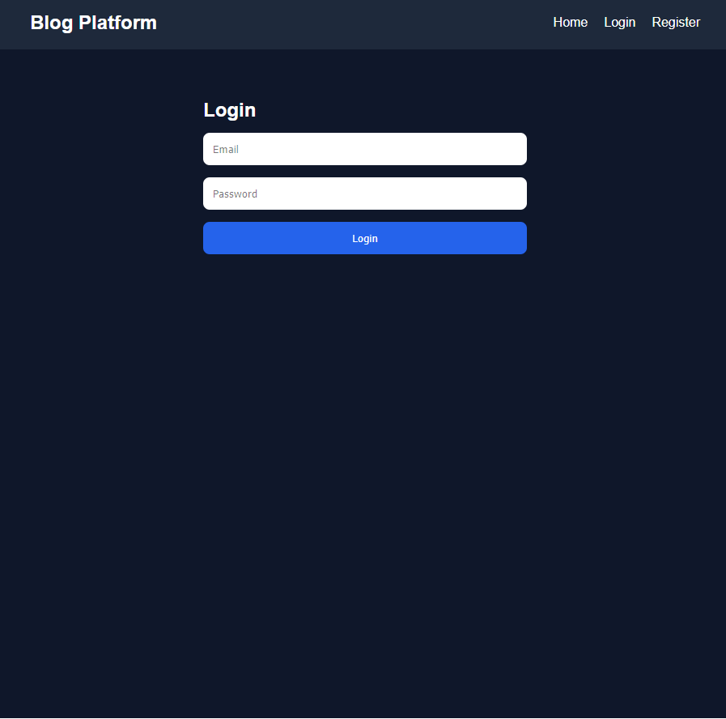
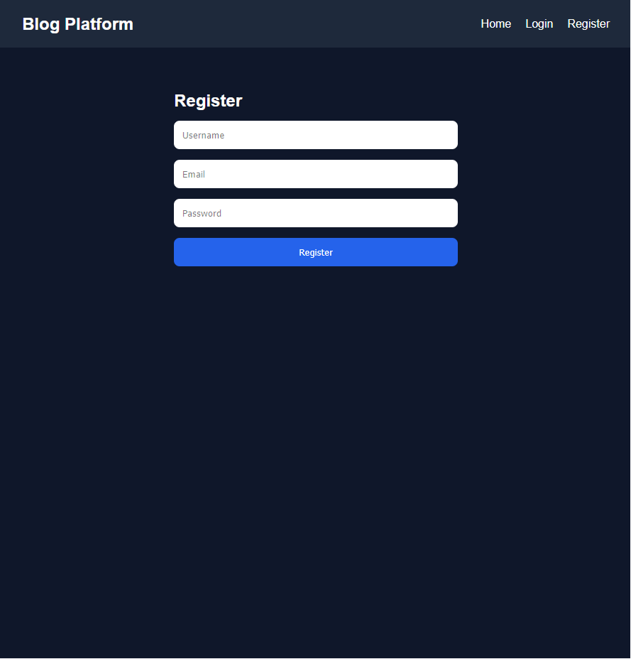
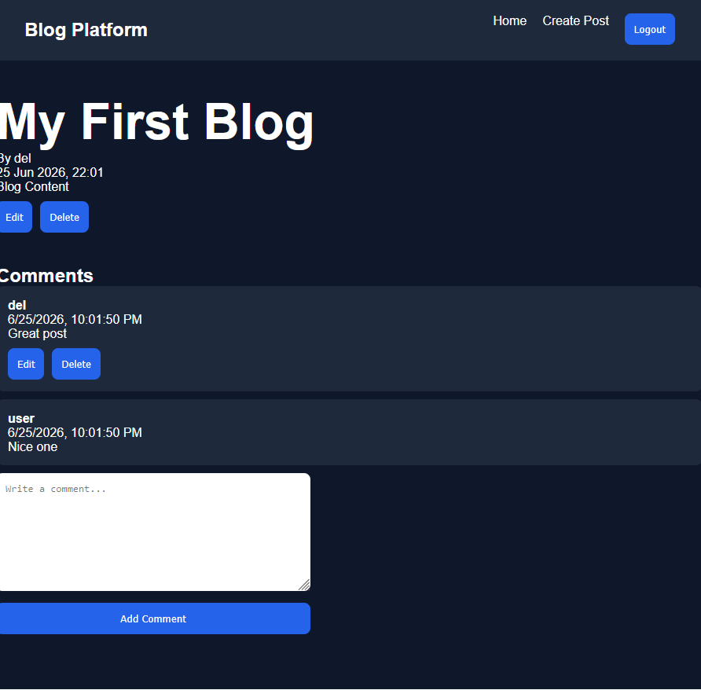
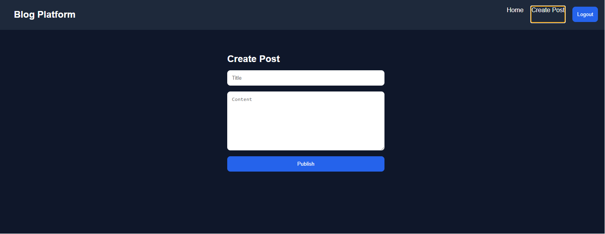
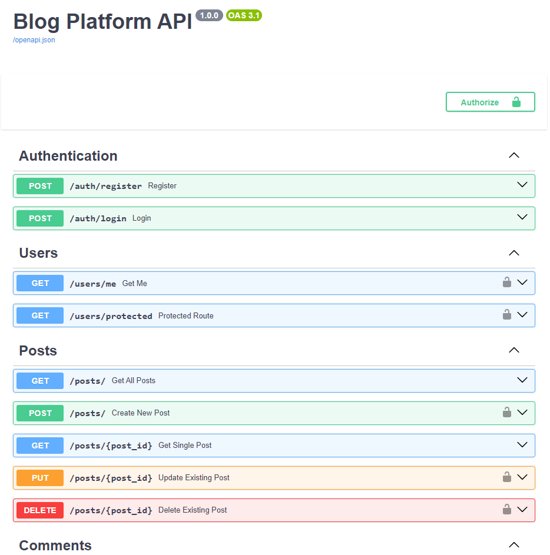
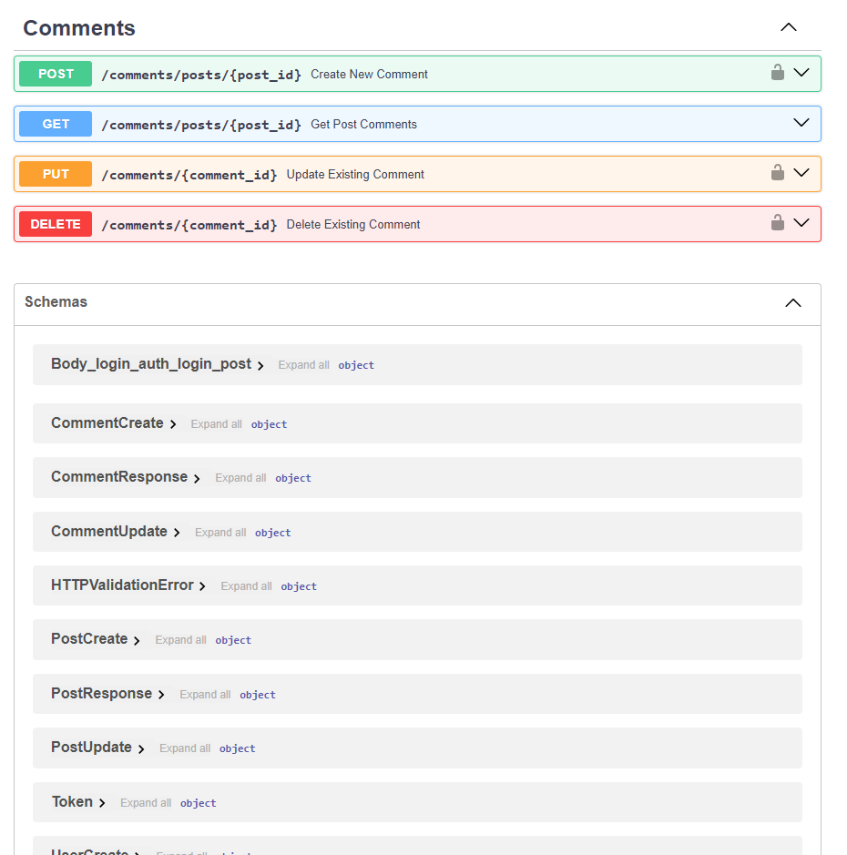

# Blog Platform

A full-stack blogging platform built with FastAPI and React.
Users can register, authenticate using JWT tokens, create blog posts, comment on posts, and manage their own content through role-based ownership controls.


## Features

* User Registration
* User Authentication (JWT)
* Create Posts
* Edit Posts
* Delete Posts
* Create Comments
* Edit Comments
* Delete Comments
* Ownership Authorization
* REST API
* Automated Testing
* SQLite Database
* Alembic Migrations

## Tech Stack

### Backend

* Python
* FastAPI
* SQLAlchemy
* Alembic
* SQLite
* JWT Authentication
* Pytest

### Frontend

* React
* Vite
* Axios
* React Router

## Screenshots

### Home page


### Login page



### Register page



### Post Details page



### Create Post page



### Swagger Documentation





## Installation

### Backend

```bash
cd backend

python -m venv venv

pip install -r requirements.txt

copy .env.example .env

alembic upgrade head

uvicorn app.main:app --reload
```

### Frontend

```bash
cd frontend

npm install

npm run dev
```
### Tests

```bash
pytest -v
```
### Coverage

```bash
pytest --coverage=app
```

## API Endpoints

### Authentication

POST /auth/register
POST /auth/login

### Posts

GET /posts
GET /posts/{id}
POST /posts
PUT /posts/{id}
DELETE /posts/{id}

### Comments

GET /comments/posts/{post_id}
POST /comments/posts/{post_id}
PUT /comments/{comment_id}
DELETE /comments/{comment_id}

## Future Improvements

* User Profiles
* Post Categories
* Rich Text Editor
* Image Uploads
* Search Functionality
* Pagination
* Docker Support
* PostgreSQL Deployment

## License

MIT
